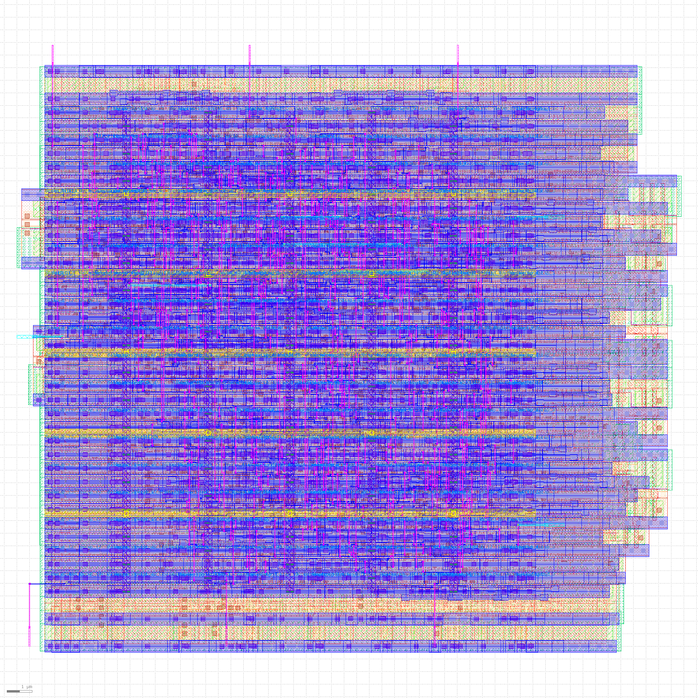
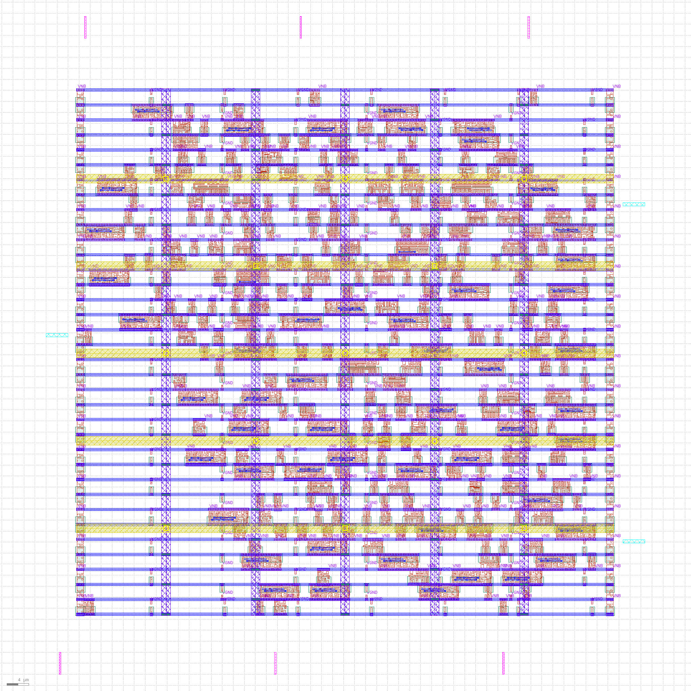
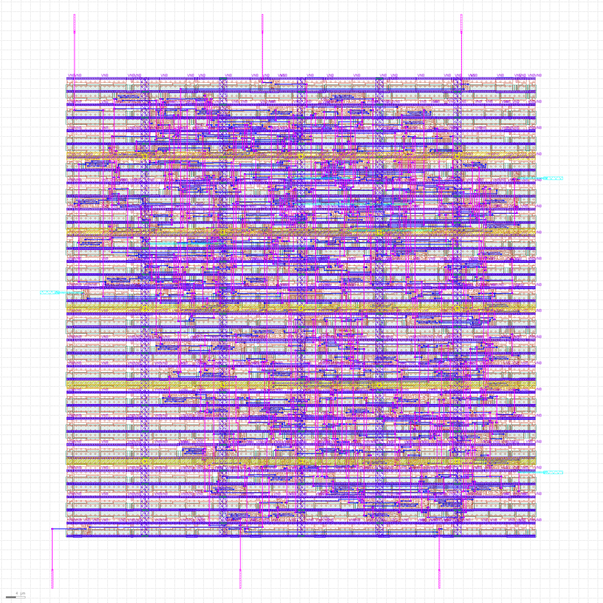

# Door Lock Controller

A keypad-based door lock controller written in Verilog as a finite state machine. It unlocks when the correct code is entered. The design was verified in simulation and taken through the OpenLane RTL-to-GDS flow on sky130_fd_sc_hd.

## Layout
- `src/` RTL and testbenches
- `deliverables/` simulation results and waveforms
- `openlane_run3/` final physical design run, GDS and STA reports
- `images/` layout and waveform screenshots

## Physical design (OpenLane, sky130_fd_sc_hd)
| Item | Result |
|---|---|
| Clock | 12 ns |
| Synthesis strategy | DELAY 0 |
| Cells | 285 |
| Die area | 0.012852 mm² |
| DRC / LVS / antenna / Magic | 0 violations |
| Worst setup slack | +0.76 ns (ss_n40C_1v28) |
| Worst hold slack | +0.17 ns (ff_n40C_1v95) |

STA was run in all 18 sky130_fd_sc_hd libraries; all pass.
An earlier AREA 0 run at 10 ns failed setup at low-voltage corners, so the final run uses DELAY 0 and a 12 ns clock.

## Verification
RTL simulation (Icarus Verilog) and gate-level simulation of the synthesized netlist both produced matching output. The gate-level simulation used the run1 netlist (231 cells, AREA 0). Run3 (285 cells, DELAY 0, 12 ns) changed only the synthesis strategy and clock period, and timing for run3 was checked with STA across all 18 libraries.

## Limitations
- Only one SPEF was used; this install has no RC-extraction rules for per-corner parasitics.
- SDF-annotated simulation and a wire-delay sensitivity check were not performed.

## Reports
- `openlane_run3/reports/` per-stage reports: synthesis, floorplan, placement, cts, routing (includes antenna), magic (DRC), lvs, klayout, cvc, manufacturability
- `openlane_run3/logs/` per-stage flow logs
- `openlane_run3/sta/` STA reports for all 18 libraries
- `comparison/` run1 (AREA 0, 10 ns) and run2 (DELAY 0, 10 ns) results
