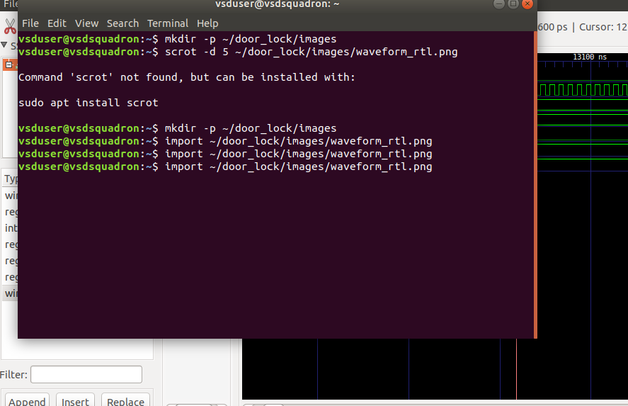
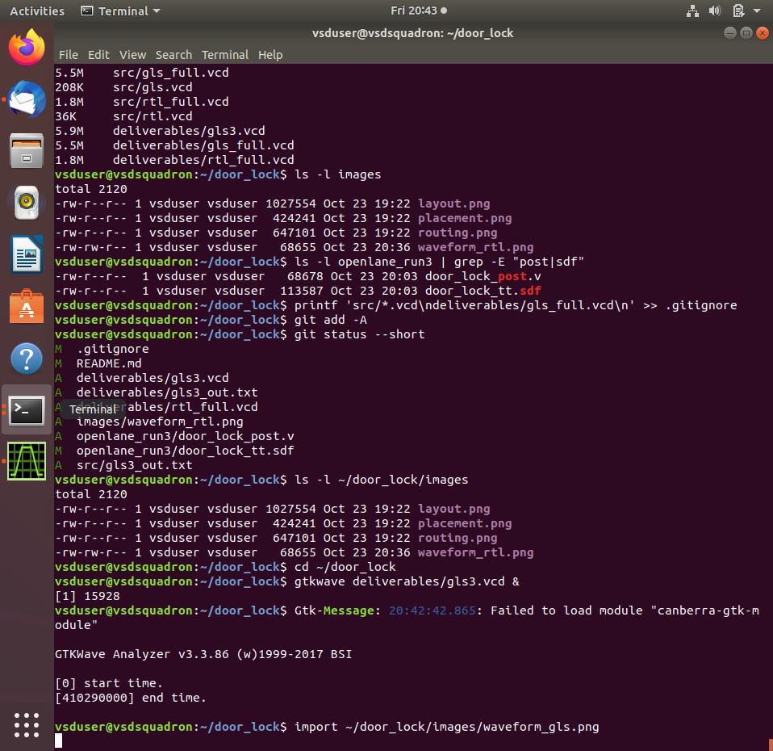

# Door Lock Controller

A 4-digit keypad door lock controller in Verilog (FSM). It unlocks when the correct code (default 1234) is entered, relocks after a timer (5000 cycles), raises an alarm and locks out entry (30000 cycles) after 3 wrong codes, and ignores keys during lockout. The code, timers and attempt limit are module parameters. The design was verified in simulation and taken through the OpenLane RTL-to-GDS flow on sky130_fd_sc_hd.

## Layout
- `src/` RTL and testbenches
- `deliverables/` simulation results and waveforms
- `openlane_run3/` final physical design run, GDS and STA reports
- `images/` layout and waveform screenshots

## Physical design (OpenLane, sky130_fd_sc_hd)
| Item | Result |
|---|---|
| Clock | 12 ns |
| Synthesis strategy | DELAY 0 |
| Cells | 285 |
| Die area | 0.012852 mm² |
| DRC / LVS / antenna / Magic | 0 violations |
| Worst setup slack | +0.76 ns (ss_n40C_1v28) |
| Worst hold slack | +0.17 ns (ff_n40C_1v95) |

STA was run in all 18 sky130_fd_sc_hd libraries; all pass.
An earlier AREA 0 run at 10 ns failed setup at low-voltage corners, so the final run uses DELAY 0 and a 12 ns clock.

## Verification
The testbench (`tb_door_lock.v`, gate-level version `tb_gls.v`) runs 18 self-checking tests: correct code unlocks with no alarm, relock after the unlock timer, each of the 4 digits rejected when wrong, unlock after 2 wrong codes plus a correct one, attempt counter reset by a correct code, alarm after 3 wrong codes, keys ignored during lockout, lockout ends after its timer, a held key counted once, and reset mid-entry. All 18 pass in RTL simulation (Icarus Verilog) and in gate-level simulation on the final run3 synthesized netlist (285 cells, DELAY 0, 12 ns). The two outputs match exactly (`diff` clean). Timing for run3 was checked with STA across all 18 libraries.

## Limitations
- Only one SPEF was used; this install has no RC-extraction rules for per-corner parasitics.
- SDF-annotated simulation and a wire-delay sensitivity check were not performed.

## Reports
- `openlane_run3/reports/` per-stage reports: synthesis, floorplan, placement, cts, routing (includes antenna), magic (DRC), lvs, klayout, cvc, manufacturability
- `openlane_run3/logs/` per-stage flow logs
- `openlane_run3/sta/` STA reports for all 18 libraries
- `openlane_run3/door_lock_post.v` and `door_lock_tt.sdf` post-route netlist and typical-corner SDF
- `deliverables/` simulation outputs and waveforms
- `comparison/` run1 (AREA 0, 10 ns) and run2 (DELAY 0, 10 ns) results

## Synthesis
- Netlist: `openlane_run3/door_lock.synthesis.v` (285 cells, DELAY 0)
- Reports: `openlane_run3/reports/synthesis/`
- Snapshot: `images/synth_run3.svg`

## Waveforms

